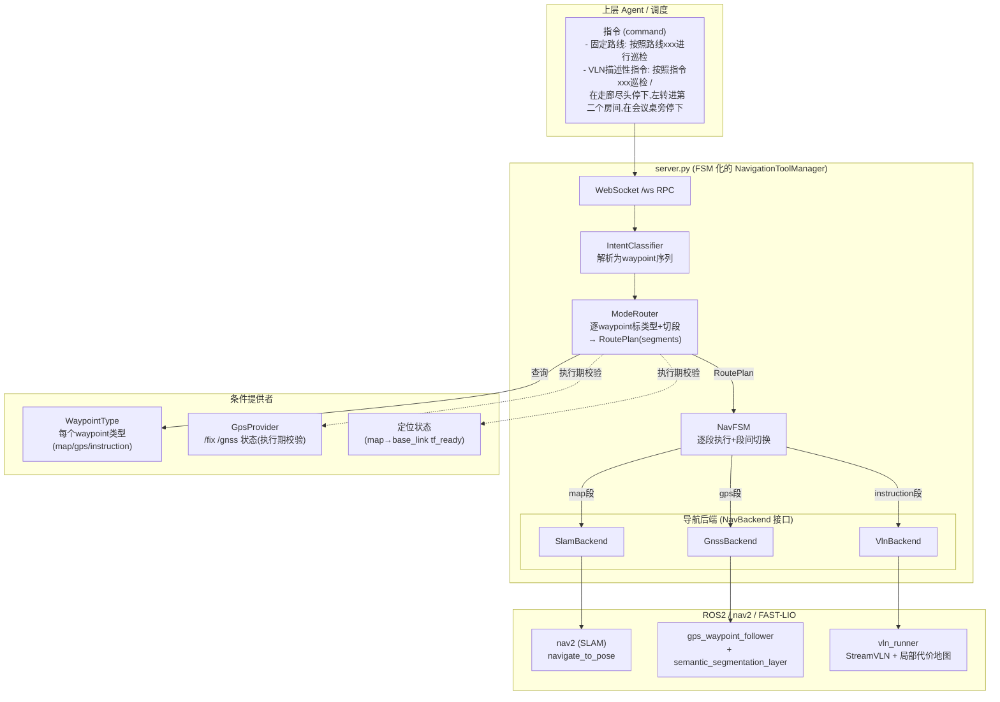
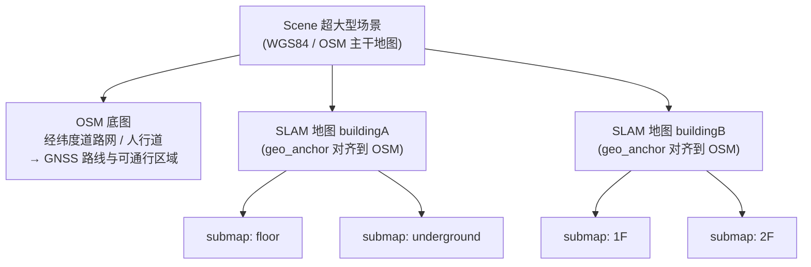
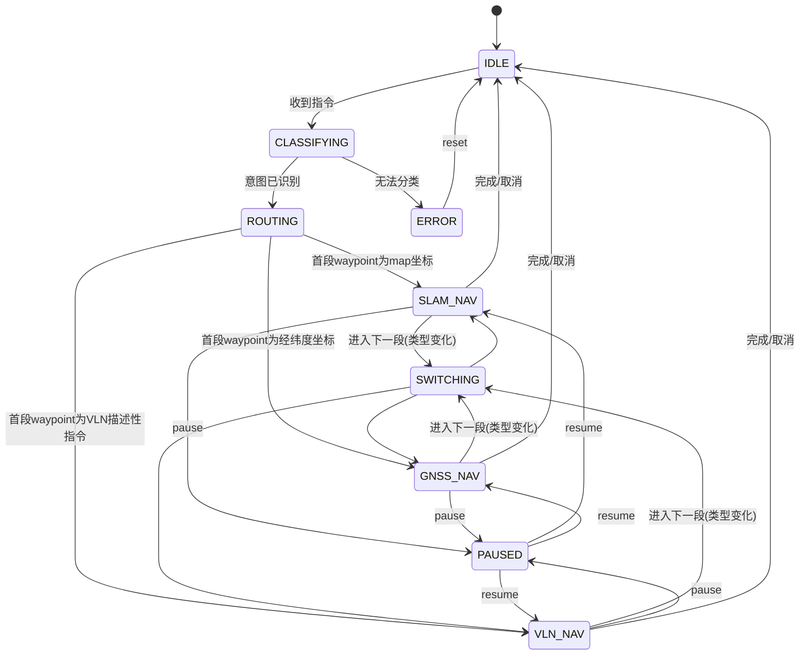
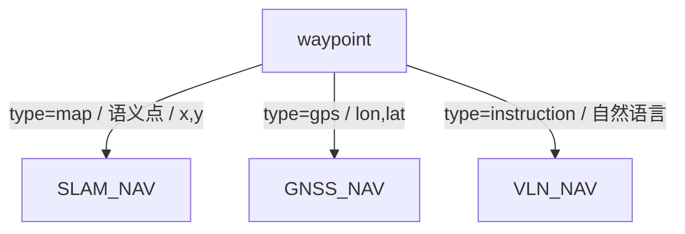
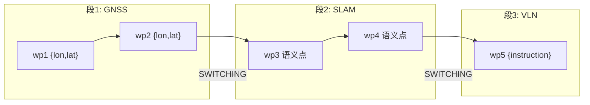
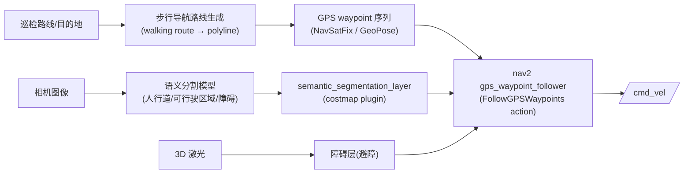
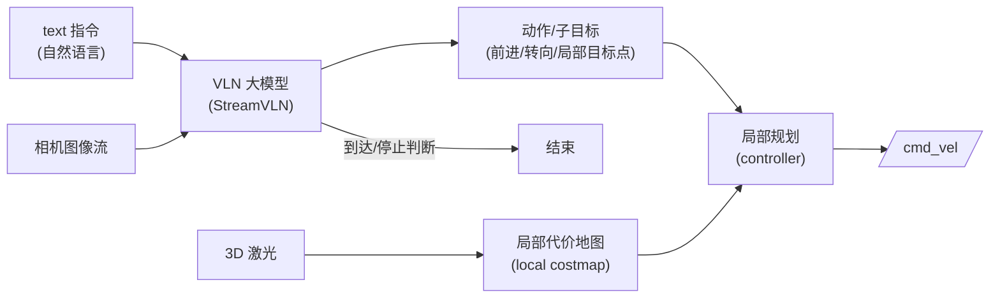

# 多模态导航 FSM 设计文档（SLAM / GNSS / VLN）

> 状态：设计草案（Draft）
> 适用范围：`NaviSkill/server.py` 及其依赖的 `nav_node.py` / `map_manager.py`，以及
> `ros2_ws` 中的 nav2 / FAST-LIO 导航栈。
> 关联文档：[`submap_system.md`](./submap_system.md)、[`ros_topics.md`](./ros_topics.md)、
> [`NAVIGATION_WEBSOCKET_API.md`](./NAVIGATION_WEBSOCKET_API.md)、[`vpr_bootstrap.md`](./vpr_bootstrap.md)

---

## 1. 背景与目标

当前 `server.py`（`NavigationToolManager`）只实现了一种导航能力：**基于 SLAM 点云地图
（FAST-LIO + nav2）的定点 / 路线导航**，对外通过 WebSocket RPC 暴露 `set_goal_by_slam`、
`set_goal_by_outdoor`、`get_route` 等方法（换图无独立 RPC，由 `set_goal_by_slam` 内部自动完成）。它隐含的假设是：

- 机器人始终运行在一张已建好的 SLAM 点云地图（submap）里；
- 目标点都来自地图配置文件中预定义的语义点位 / 路线；
- 定位依赖 `map → base_link` 的 TF（必要时由 VPR 触发重定位）。

本设计在不破坏现有 SLAM 能力的前提下，把 `server.py` 扩展为一个**导航有限状态机
（FSM, Finite State Machine）**，新增两种导航模式：

1. **GNSS 导航**：在没有 SLAM 地图覆盖、但有 GPS 信号的室外区域，基于步行导航生成的
   GPS waypoint 走 `gps_waypoint_follower`，并对相机图像做语义分割生成
   `semantic_segmentation_layer`，让机器人沿人行道行走并避障。
2. **VLN 导航（Vision-Language Navigation）**：面向 **VLN 描述性指令**（自然语言），机器人基于
   text 指令 + 图像调用 VLN 大模型（如 StreamVLN）进行推理决策，底层用 3D 激光生成局部
   代价地图做避障。

并由 FSM 把每条路线解析成异构 waypoint 序列，**逐 waypoint 按类型（map / gps / VLN 描述性指令）路由到
对应导航后端**，在段间自动切换——因此**同一条路线可同时包含 GNSS、SLAM 与 VLN 三种导航**。

### 1.1 决策总览

本设计支持**一条路线内同时混用 GNSS / SLAM / VLN 三种导航**：路线是一个**异构 waypoint 序列**，
机器人**逐个 waypoint** 判断其类型并调用对应的导航后端，在相邻类型不同的 waypoint 之间自动切换
导航模式。因此决策的粒度是 **每个 waypoint（段）**，而不是整条路线。

```
            收到指令 → 取得 waypoint 序列（路线）
                          │
        逐个 waypoint 判断其类型并路由：
                          │
   ┌──────────────┬───────────────┬──────────────┐
 map 坐标系坐标   经纬度(GPS)坐标   一段VLN描述性指令
 {x,y}/语义点     {lon,lat}        {instruction:文本}
      │               │                  │
  SLAM 导航        GNSS 导航          VLN 导航
      └──────── 沿路线推进时按需切换模式 ───────┘
```

用文字复述判定规则（**逐 waypoint**）：

- waypoint 是 **map 坐标系坐标**（`{x, y}` 或引用语义点）→ **SLAM 导航**；
- waypoint 是 **经纬度（GPS）坐标**（`{lon, lat}`）→ **GNSS 导航**；
- waypoint 是 **一段 VLN 描述性指令**（自然语言 `{instruction: "..."}`）→ **VLN 导航**。

> 一条路线可以是「室外 GPS 段（GNSS）→ 进楼后定点段（SLAM）→ 末端 VLN 段如『在会议桌旁停下』
> （VLN）」的任意组合；执行器按序推进并在段间切换模式。纯 VLN 描述性指令（不引用具名路线）等价于一条
> 只有单个 VLN waypoint 的路线。

---

## 2. 现状梳理（作为扩展基线）

| 组件 | 角色 | 关键点 |
|------|------|--------|
| `server.py` / `NavigationToolManager` | WebSocket RPC 服务 + ROS 编排 | `register_tools()` 注册 ~27 个 handler；`call_method` 统一调度；`start()` 跑 FastAPI `/ws`。 |
| `nav_node.py` / `NavNode` | ROS2 节点 | 订阅 `/map`、相机、`/plan`、`/odom` 等；发布 `/cmd_vel`、`/change_map`、`/pose_in_target`；`navigate_to_pose` action client；`map→base_link` TF 定位与新鲜度判定。 |
| `map_manager.py` / `MapManager` | 多 submap / 点位 / 路线 / 传送门 | `get_route_by_name` 返回扁平 `[{submap, semantic_point}]`；`get_submap_list`、点位坐标、跨图变换。 |
| `vpr_bootstrap.py` | VPR 子进程 + 重定位编排 | 启动引导 submap、`tf_ready` 丢失后触发共识重定位。 |
| nav2 + FAST-LIO（`ros2_ws`） | 底层导航栈 | `r1pro_nav2.launch.py` 起 bringup；点云地图定位；costmap / controller。 |

现有逻辑里已有一个**隐式的「指令路由」**雏形：`set_goal_by_slam`（语义点）/
`set_goal_by_outdoor`（经纬度）/ `get_route`（路线）。本设计把这种「按入参选择行为」的零散逻辑
**收敛进一个显式的 FSM**，并在其之上挂三套导航后端。

---

## 3. 总体架构



### 3.1 设计原则

1. **后端可插拔**：三种导航各自实现统一的 `NavBackend` 接口，FSM 只与接口交互。
2. **单一活跃后端**：任一时刻最多一个后端处于 `RUNNING`，切换时先停旧后端再起新后端。
3. **向后兼容**：现有 RPC（`set_goal_by_slam` 等）保持可用，内部转调 SLAM 后端，不破坏老客户端。
4. **逐 waypoint 路由 + 混合路线**：一条路线可混用三种导航；按 waypoint 类型切分为段，段间自动
   切换后端。返回结构化的 `segments` 计划（每段 mode/type/waypoints），便于上层与排障。

---

## 4. 地图结构（分层地图模型）

### 4.1 为什么要扩展地图描述文件

现有地图描述文件（`multifloor.json`，详见 [`submap_system.md`](./submap_system.md)）已经支持
**多个子地图（submap）**：每个 submap 是一张 SLAM 点云地图，submap 之间通过 `transform`
对齐到一个公共的 `default_submap` 坐标系，并用 portal 互相连接。

但对**超大型场景**（如整个园区 / 多栋楼 + 室外道路网络）来说，「单张 SLAM 地图 + 多 submap」
的模型不够用：

- 整个园区不可能、也不应该建成一张连续的 SLAM 点云地图（建图/定位代价、漂移累积、维护困难）；
- 室外大范围区域更适合用**经纬度坐标系**描述，而不是某张 SLAM 地图的局部 `map` 系；
- 一个园区里会有**多张相互独立的 SLAM 地图**（例如每栋楼一张），它们各自又含多个 submap。

因此本设计在 submap 之上再加一层，形成**三层分层地图模型**，并以 **OpenStreetMap（OSM，
经纬度坐标系）作为整个超大型场景的主干**，把各张 SLAM 地图**对齐（锚定）到 OSM** 上。

### 4.2 分层模型



| 层级 | 坐标系 | 角色 | 对应导航 |
|------|--------|------|----------|
| **Scene（场景）** | WGS84 经纬度（OSM） | 超大型场景主干：OSM 道路/人行道网络、跨地图的全局路线、各 SLAM 地图的地理位置 | GNSS（室外、无 SLAM 覆盖区） |
| **SLAM 地图（slam_map）** | 各自的局部 `map` 系（FAST-LIO 点云地图） | 一片连续可 SLAM 定位的区域（如一栋楼）；通过 `geo_anchor` 锚定到 OSM | SLAM |
| **子地图（submap）** | `map` 系（相对所属 SLAM 地图的 `default_submap`） | 现有结构：语义点位、portal、跨 submap `transform`（**不变**） | SLAM |

关键关系：

- **OSM 是主干**：超大型场景的整体拓扑、室外通行网络、SLAM 地图的摆放位置，全部以经纬度表达。
- **SLAM 地图对齐到 OSM**：每张 SLAM 地图带一个 `geo_anchor`，描述其局部 `map` 原点在 WGS84
  中的经纬度与朝向，从而把整张 SLAM 地图「贴」到 OSM 上。
- **一个场景可有多张 SLAM 地图**，每张 SLAM 地图内部仍是「多 submap」结构（复用现有实现）。

### 4.3 地图描述文件扩展

在现有结构外**向上包一层**，并保持 submap 子结构与现有 `multifloor.json` 完全兼容：

```json
{
  "scene": {
    "name": "XX 园区",
    "crs": "WGS84",
    "osm": {
      "source": "xx_park.osm",
      "bounds": {
        "min": {"lon": 113.9295, "lat": 22.5298},
        "max": {"lon": 113.9330, "lat": 22.5325}
      }
    }
  },

  "slam_maps": {
    "buildingA": {
      "name": "A 栋",
      "geo_anchor": {
        "origin": {"lon": 113.9301, "lat": 22.5302, "alt": 0.0},
        "heading_deg": 37.5,
        "_comment": "该 SLAM 地图 default_submap 的 map 原点在 WGS84 的位置与朝向(ENU)"
      },
      "default_submap": "floor",
      "submaps": {
        "floor":       { "...": "复用现有 submap 结构(map_file/transform/semantic_points/...)" },
        "underground": { "...": "..." }
      }
    },
    "buildingB": {
      "name": "B 栋",
      "geo_anchor": { "origin": {"lon": 113.9318, "lat": 22.5316}, "heading_deg": -12.0 },
      "source": "buildingB/buildingB.json",
      "_comment": "以引用方式嵌入：default_submap/submaps 从独立 JSON 文件加载"
    }
  },

  "routes": {
    "室外周界巡检": {
      "description": "园区外围人行道一圈（OSM/经纬度路线）",
      "waypoints": [
        {"lon": 113.9301, "lat": 22.5302},
        {"lon": 113.9320, "lat": 22.5318}
      ]
    },
    "A栋一层巡检": {
      "description": "A 栋一层室内（SLAM 路线）",
      "waypoints": [
        {"slam_map": "buildingA", "submap": "floor", "semantic_point": "会议桌"},
        {"slam_map": "buildingA", "submap": "floor", "semantic_point": "配电房"}
      ]
    },
    "周界到会议室巡检": {
      "description": "混合路线：室外GPS段(GNSS) → 进楼定点段(SLAM) → 末端VLN段(VLN)",
      "waypoints": [
        {"lon": 113.9301, "lat": 22.5302},
        {"lon": 113.9320, "lat": 22.5318},
        {"slam_map": "buildingA", "submap": "floor", "semantic_point": "大厅入口"},
        {"slam_map": "buildingA", "submap": "floor", "semantic_point": "会议室门口"},
        {"instruction": "进门后在会议桌旁停下，面向白板"}
      ]
    }
  }
}
```

上面 `周界到会议室巡检` 即一条**同时用到三种导航**的路线，`ModeRouter` 会把它切成 3 段（详见
§6.2）：`gps`×2 → **GNSS**，`map`×2 → **SLAM**，`instruction`×1 → **VLN**，执行时按序推进并在段间
自动切换后端。

新增字段说明：

| 字段 | 说明 |
|------|------|
| `scene` | 场景级元信息；`osm` 指向 OSM 数据源与经纬度范围。 |
| `slam_maps.<id>` | 一张 SLAM 地图；其 `submaps` 子结构**完全复用现有 submap 定义**。可**内联**（如 `buildingA`）或**引用外部 JSON**（如 `buildingB`，见下）。 |
| `slam_maps.<id>.geo_anchor` | SLAM 地图 → WGS84 的锚定（§4.4）。 |
| `slam_maps.<id>.source` | 可选。指向一个**独立的 SLAM 地图 JSON 文件**（相对 scene 文件目录或绝对路径）；提供时该 SLAM 地图的 `default_submap` / `submaps` 从该文件加载，scene 文件里无需内联。 |
| `routes[].waypoints[].slam_map` | SLAM 路线 waypoint 新增的所属 SLAM 地图标识；省略时回退到当前/默认 SLAM 地图（向后兼容单 SLAM 地图场景）。 |

#### 以引用方式嵌入独立 SLAM 地图文件

每张 SLAM 地图可以**整体放在自己的独立 JSON 文件**里（就是一份标准的、与现有 `multifloor.json`
同构的 SLAM 地图配置），scene 文件只通过 `source` 引用它并提供 `geo_anchor`。`MapManager` 加载
scene 时，对带 `source` 的条目读取并合并该外部文件的 `default_submap` / `submaps`。

`buildingB/buildingB.json`（独立文件，内容即现有单图配置结构）：

```json
{
  "global": { "default_submap": "1F" },
  "submaps": {
    "1F": { "map_file": "1F_2cm.pcd", "transform": { "...": "..." }, "semantic_points": { "...": "..." } },
    "2F": { "map_file": "2F_2cm.pcd", "transform": { "...": "..." }, "semantic_points": { "...": "..." } }
  }
}
```

合并规则与约定：

- **就地展开**：`source` 文件被加载后，等价于把其 `submaps` / `default_submap` 内联到对应
  `slam_maps.<id>` 下；`geo_anchor`（以及 `name`）仍以 scene 文件中的为准。
- **字段优先级**：scene 条目里显式写出的字段覆盖外部文件同名字段（便于在场景级微调，如改
  `default_submap`）。
- **内联与引用可混用**：同一 scene 里部分 SLAM 地图内联、部分用 `source` 引用都允许（示例中
  `buildingA` 内联、`buildingB` 引用）。
- **复用性**：独立文件本身就是一份合法的单图 `multifloor.json`，既可被 scene 引用组装进超大型
  场景，也可被单独加载用于只跑这一栋楼的场景（便于分栋建图/维护、按需加载）。
- **路径与防环**：`source` 相对路径以 scene 文件所在目录解析；建议禁止/检测循环引用与多层
  `source` 嵌套（外部文件内不应再出现 `scene`/`slam_maps`）。

> **向后兼容**：现有单张 SLAM 地图的 `multifloor.json` 视为「只有一个 `slam_map` 的退化场景」。
> 可让 `MapManager` 在加载时：若无 `scene`/`slam_maps` 顶层键，则把整个文件包装成单个隐式
> `slam_map`（无 `geo_anchor` 时仅支持 SLAM、不支持 GNSS 对齐），从而老配置零改动继续工作。
> 这也正是 `source` 引用的外部文件所采用的格式——两种用法天然一致。

### 4.4 SLAM 地图到 OSM 的对齐（geo_anchor）

`geo_anchor` 定义一张 SLAM 地图局部 `map` 系（其 `default_submap` 原点）在 WGS84 中的位姿：

- `origin = {lon, lat, alt}`：`map` 原点对应的经纬度；
- `heading_deg`：`map` 系 +X 轴相对 ENU 正东（East）的方位角（逆时针为正）。

坐标换算（复用 `wgs84.py` 的 `WGS84Converter`，**每张 SLAM 地图实例化一个**，以各自 anchor 为原点）：

```
SLAM map 点 (x, y)
   │  ① 按 heading 旋转到 ENU 局部平面: (e, n) = R(heading) · (x, y)
   ▼
ENU 局部 (e, n)  ──②  WGS84Converter(origin).xy_to_lonlat ──▶  (lon, lat)   # SLAM → OSM
(lon, lat) ──②'  WGS84Converter(origin).lonlat_to_xy ──▶ (e, n) ──①' R(-heading)──▶ (x, y)  # OSM → SLAM
```

完整的「submap 点 → 经纬度」链路 = 现有 **submap→default_submap**（`transform`，见
[`submap_system.md`](./submap_system.md)）叠加新增 **default_submap→WGS84**（`geo_anchor`）。

这套对齐是「原来的 SLAM 地图对齐到 OpenStreetMap」的落地：既支持把 SLAM 内的点位投影到 OSM
做全局展示/跨地图规划，也支持把 OSM/GPS 位置反算到某张 SLAM 地图的 `map` 系，用于
**进入 SLAM 地图区时的初始定位**（配合现有 `/pose_in_target`）。

### 4.5 地图结构与导航模式的关系

| 场景区域 | 地图来源 | 路线 waypoint 坐标 | 导航模式 |
|----------|----------|--------------------|----------|
| 室外、无 SLAM 覆盖 | OSM 主干 | 经纬度 `{lon, lat}` | GNSS |
| 某张 SLAM 地图覆盖范围内 | slam_map + submap | `{slam_map, submap, semantic_point}` 或 `{x, y}` | SLAM |
| 任意（VLN 描述性指令） | 实时感知，不依赖预存地图 | —（自然语言） | VLN |

由此，第 6 章的「逐 waypoint 类型 → 选 SLAM/GNSS/VLN」裁决，本质就是在分层地图模型里判断每个
waypoint 落在 **OSM 主干层**（gps→GNSS）、某张 **SLAM 地图层**（map→SLAM）还是**不依赖预存
地图的实时 VLN 推理**（instruction→VLN）。一条路线可在这几层之间穿插，执行器按段切换；多张 SLAM
地图之间的切换，由 SLAM 后端在 slam_map 维度扩展现有的 submap 切换逻辑完成（详见 §8.1）。

---

## 5. 有限状态机（FSM）

### 5.1 状态定义

| 状态 | 含义 |
|------|------|
| `IDLE` | 空闲，无导航任务。 |
| `CLASSIFYING` | 正在解析指令（具名路线 vs VLN 描述性指令），产出 waypoint 序列。 |
| `ROUTING` | 已分类，正在裁决具体导航模式（GNSS / SLAM / VLN）。 |
| `SLAM_NAV` | SLAM 导航执行中。 |
| `GNSS_NAV` | GNSS 导航执行中。 |
| `VLN_NAV` | VLN 导航执行中。 |
| `SWITCHING` | 模式切换过渡态（停旧后端、做坐标/定位衔接、起新后端）。 |
| `PAUSED` | 已暂停（保留当前后端上下文）。 |
| `ERROR` | 异常态（后端失败 / 条件缺失），可恢复回 `IDLE`。 |

### 5.2 状态转移图



### 5.3 转移触发源

- **外部 RPC**：`navigate(command)`、`pause_navigation`、`resume_navigation`、`cancel_navigation`。
- **路线段推进（主要触发源）**：执行器完成当前段最后一个 waypoint 后，若下一段类型不同，则触发
  `SWITCHING` 切换到对应后端；整条路线全部段完成后回 `IDLE`。一条混合路线在执行期会经历
  多次 `*_NAV → SWITCHING → *_NAV`。
- **后端回调**：到达 / 失败 / 卡死（复用现有 `check_goal_reached`、卡住检测）。
- **条件监视**：后台协程周期性检查执行期健康度（GNSS 段的 GPS 信号、SLAM 段的 `tf_ready`）；
  用于当前段后端失效时触发 `ERROR`。注意 waypoint 类型（即用哪种导航）在路线编排时已固定，
  监视只服务于「当前段是否还能继续」，不改变路由结果。

---

## 6. 指令分类与模式裁决

### 6.1 IntentClassifier（解析为 waypoint 序列）

由于一条路线可混用三种导航，分类器的职责从「整条命令二选一」改为：**把指令解析成一个
统一的 waypoint 序列**，序列中的每个元素带 `type`（`map` / `gps` / `instruction`），交给
`ModeRouter` 逐个路由。

输入到输出的两种典型形态：

| 指令形式 | 解析结果 |
|----------|----------|
| 「按照**路线** `xxx` 进行巡检」——引用具名路线 | `map_manager.get_route_by_name(xxx)` 展开为 waypoint 序列；序列里**可同时包含** map / gps / instruction 三类元素 |
| 一段**自由自然语言**（如「在走廊尽头停下，左转进第二个房间，在会议桌旁停下」） | 解析为**单个 `instruction` 类型 waypoint**（整段文本交给 VLN）；等价于只有一个 VLN 段的路线 |

判定优先级（从强到弱）：

1. **显式字段**：指令带 `task_type` / `route` / `instruction` 字段（推荐，最可靠）：
   - 含 `route`（路线名）→ 展开为 waypoint 序列（可混合三类）；
   - 仅含自由文本 `instruction`（无具名路线）→ 单个 `instruction` waypoint。
2. **关键词 + 路线名解析**：无显式字段时——
   - 文本形如「按照路线 `<NAME>` 进行巡检」，且 `<NAME>` 能被
     `map_manager.get_route_by_name(NAME)` 命中 → 展开该路线；
   - 否则（「按照指令 …」或含相对空间动作词：停下 / 左转 / 右转 / 进 / 第…个 / 尽头 / 旁边 /
     前面 等）→ 整段作为 `instruction` waypoint。
3. **兜底**：无法解析为已知路线 → 作为 `instruction` waypoint（交给 VLN）。

> 说明：
> - 「按照路线 xxx 巡检」与「按照指令 xxx 巡检」字面都含「巡检」二字，**不能只靠是否出现
>   「巡检」来分类**；真正的判据是 `xxx` 能否解析为已知路线名（能→展开路线；不能→交给 VLN）。
> - 路线内的某个 waypoint 本身也可以是 `instruction` 类型（在路线配置里直接写一段 VLN 描述性指令，
>   见 §6.3 / §11），从而把 VLN 段嵌入巡检路线。
> - 分类器先用规则；规则不确定时可调用一次轻量 LLM 兜底（可选，不阻塞主链路）。

### 6.2 ModeRouter（逐 waypoint：GNSS / SLAM / VLN）

`ModeRouter` 遍历 waypoint 序列，对**每个 waypoint** 按其 `type` 选定后端，并把连续同类型的
waypoint 合并成一个**段（segment）**交给同一个后端连续执行；段与段之间触发 FSM `SWITCHING`。
**与当前 GPS 信号强弱无关**——类型在路线编排时已固定，GPS/定位仅用于执行期校验。



逐 waypoint 路由 + 段切换示意（一条混合路线）：



裁决所需的条件来源：

| 条件 | 提供者 | 判定方式 |
|------|--------|----------|
| waypoint 类型 | `MapManager` / 路线配置 | 见 §6.3：`map`（`{x,y}` 或语义点）/ `gps`（`{lon,lat}`）/ `instruction`（自然语言文本）。 |
| 是否已定位（SLAM 段执行期校验） | `NavNode.is_map_localized()` | 复用现有 `tf_ready` 判定。 |
| 有无 GPS 信号（GNSS 段执行期校验） | `GpsProvider` | 订阅 `sensor_msgs/NavSatFix`（`/gnss/fix` 或 `/fix`）：`status >= STATUS_FIX` 且定位年龄 < 阈值（如 2s）。**不参与类型选择**，仅在执行 GNSS 段时校验（无 GPS 则该段报错）。 |

**裁决输出**（结构化，写回 RPC 结果，便于排障）：把整条路线切分成有序的 segment 计划：

```json
{
  "route_name": "周界到会议室巡检",
  "waypoint_count": 5,
  "segments": [
    {"index": 0, "mode": "GNSS_NAV", "type": "gps",         "waypoints": [0, 1]},
    {"index": 1, "mode": "SLAM_NAV", "type": "map",         "waypoints": [2, 3]},
    {"index": 2, "mode": "VLN_NAV",  "type": "instruction", "waypoints": [4]}
  ],
  "rule": "per_waypoint_routing"
}
```

### 6.3 waypoint 类型识别（WaypointType）

逐 waypoint 路由的关键是判断每个 waypoint 的类型。`MapManager.get_route_by_name` 展开后的每个
waypoint 经如下规则归类，并标注 `type` 供 `ModeRouter` 读取：

| waypoint 形式 | `type` | 走向 |
|---------------|--------|------|
| `{(slam_map,) submap, semantic_point}`（引用语义点，坐标解析为 map 系 `{x, y}`；`slam_map` 省略则用默认/当前 SLAM 地图） | `map` | SLAM |
| `{x, y, (yaw)}`（直接 map 坐标） | `map` | SLAM |
| `{lon, lat, (yaw)}`（经纬度 / OSM 主干 / GPS） | `gps` | GNSS |
| `{instruction: "..."}`（一段 VLN 描述性指令，自然语言） | `instruction` | VLN |

实现要点：

- **允许同一路线混用三种类型**（这是本设计的核心能力）：`MapManager` 在展开路线时**不再因
  类型混用而报错**，而是为每个 waypoint 标注 `type`，并把相邻同类型的 waypoint 归并成段。
- map / gps / instruction 三类 waypoint 均为路线配置可直接书写的形式（见 §11）；`MapManager`
  原样透传 `{lon,lat}` 与 `{instruction}`，并解析 `{slam_map, submap, semantic_point}` 为坐标。
- 段边界 = 相邻 waypoint 的 `type` 发生变化处；执行器在段边界做模式切换（§5.2 `SWITCHING`）。

---

## 7. 后端接口

所有导航模式实现统一接口，FSM 只依赖它：

```python
class NavBackend(Protocol):
    name: str  # "slam" | "gnss" | "vln"

    def start(self, task: NavTask) -> Dict[str, Any]:
        """启动一次导航任务；非阻塞，立即返回受理结果。"""

    def pause(self) -> Dict[str, Any]: ...
    def resume(self) -> Dict[str, Any]: ...
    def cancel(self) -> Dict[str, Any]: ...

    def status(self) -> BackendStatus:
        """RUNNING / REACHED / FAILED / CANCELLED / IDLE + 进度信息。"""

    def can_continue(self, conditions: Conditions) -> bool:
        """当前条件下本后端是否仍适用（供 FSM 决定是否 SWITCHING）。"""
```

一条路线被切分为有序的**段（Segment）**，每段交给一个后端；FSM 按序执行各段：

```python
@dataclass
class Segment:
    mode: str                   # slam | gnss | vln
    wp_type: str                # map | gps | instruction
    waypoints: list             # 本段的 waypoint（map 坐标/经纬度），或单条 instruction 文本

@dataclass
class RoutePlan:
    route_name: Optional[str]   # 具名路线（纯 VLN 描述性指令时为 None）
    segments: list              # List[Segment]，按执行顺序排列
    raw: Dict[str, Any]         # 原始指令

@dataclass
class NavTask:                  # 后端只感知「当前要执行的一段」
    mode: str                   # slam | gnss | vln
    wp_type: str                # map | gps | instruction
    waypoints: Optional[list]   # map/gps 段的 waypoint 列表
    instruction: Optional[str]  # instruction 段的自然语言
    raw: Dict[str, Any]
```

> `IntentClassifier` + `ModeRouter` 产出 `RoutePlan`（含 segment 列表）；FSM 逐段把 `Segment`
> 包装成 `NavTask` 下发给对应后端，段间触发 `SWITCHING`。

---

## 8. 三种导航模式详细设计

### 8.1 SLAM 导航（SlamBackend）

**适用**：waypoint 类型为 `map`（语义点 / `{x,y}`）的段。本质是把现有能力封装进后端。

- **目标来源**：本段的 map 坐标 waypoint 列表（由 `map_manager.get_route_by_name` 展开中
  `type==map` 的部分），逐点导航；或单点 `set_goal_by_slam`。
- **执行**：复用 `NavNode.publish_goal` + `navigate_to_pose` action；到达判定复用
  `wait_goal_reached` / `check_goal_reached`。
- **多子地图切换**：路线跨 submap 时，用 `get_portal_to_submap` 找传送门 →
  `_change_map` 完成换图与跨图位姿衔接（已有完整实现），实现「在多个子地图间切换」。
- **多 SLAM 地图切换**：超大型场景下（§4）一个 Scene 含多张 SLAM 地图，每张内部又含多 submap。
  当 waypoint 的 `slam_map` 与当前活跃 SLAM 地图不同时，需在 submap 切换之上再做一层
  **slam_map 切换**：加载目标 SLAM 地图，并用 `geo_anchor`（§4.4）把当前 GPS/位置反算为目标
  SLAM 地图 `map` 系的初始位姿（经 `/pose_in_target`），完成跨 SLAM 地图的定位衔接。
- **定位**：依赖 `map→base_link`；丢失时由现有 VPR watchdog 重定位（不变）。

> 该后端是对现有代码的**重构封装**而非重写：`set_goal_by_*`、内部 `_change_map`、路线相关 handler
> 全部委托到 `SlamBackend`，对外 RPC 行为不变。

### 8.2 GNSS 导航（GnssBackend）

**适用**：waypoint 类型为 `gps`（`{lon, lat}`）的段（典型：室外人行道、OSM 主干区）。



要点：

1. **GPS waypoint 生成**：基于**步行导航**（walking-mode routing）把「起点→巡检目的地」的
   路线规划成一串经纬度点（polyline → waypoints）。路线源可以是外部步行导航服务（如地图
   厂商 walking API）或离线人行道图层；输出统一为 `[{lon, lat, (yaw?)}]`。
2. **gps_waypoint_follower**：使用 nav2 的 `robot_localization`（`navsat_transform_node`
   把 `NavSatFix` 融合进 `map`/`odom`）+ `FollowGPSWaypoints` action，逐个 GPS waypoint 跟踪。
3. **semantic_segmentation_layer**：对相机图像做语义分割（人行道 / 可通行区域 / 障碍 / 草地
   等），投影到地面生成代价层，作为 nav2 local/global costmap 的一个 plugin，**约束机器人走
   人行道**并对图像中的障碍物加代价。
4. **激光避障**：3D 激光的障碍层并行加入 costmap，做近场实时避障（与语义层互补：语义层管
   「该不该走」，激光层管「能不能撞」）。
5. **无需 SLAM 定位**：该模式不依赖 `map→base_link` 的点云定位，定位以 GNSS + 轮速 + IMU 融合
   为主。

需要新增的 ROS 侧能力（详见 §10）：`navsat_transform`、`gps_waypoint_follower`、
分割推理节点 `semantic_seg_node` + costmap 插件 `semantic_segmentation_layer`。

### 8.3 VLN 导航（VlnBackend）

**适用**：waypoint 类型为 `instruction`（一段 VLN 描述性指令，自然语言）的段——既可以是整条独立的
VLN 描述性指令，也可以是嵌在巡检路线中间/末端的某一段（如「在会议桌旁停下」）。



要点：

1. **推理回路**：以「图像帧 + 文本指令 + 历史」为输入，调用 VLN 大模型（StreamVLN）流式
   推理，输出离散动作或局部子目标（waypoint），形成「感知→推理→动作」闭环。
2. **模型部署**：与 VPR 子进程一致的隔离思路——`VlnRunner` 跑在**独立进程 / 独立 venv**
   （GPU 显存与 ROS 主进程隔离），通过 IPC（共享内存 / 本地 socket）与 `VlnBackend` 通信。
   参考 `vpr_bootstrap.py` 的子进程编排与就绪等待模式。
3. **底层避障**：3D 激光生成**局部代价地图**（local costmap，可复用 nav2 costmap_2d +
   `pointcloud_to_laserscan` / `cloud_to_laserscan`），把 VLN 输出的子目标交给局部 controller
   执行，保证避障安全兜底（VLN 给方向，costmap 保证不撞）。
4. **安全约束**：VLN 输出经速度限幅、碰撞预测过滤后才下发 `/cmd_vel`；激光近距离急停优先级最高。
5. **结束条件**：VLN 判定「已到达 / 任务完成」或上层 `cancel`。

---

## 9. server.py 的 FSM 化改造

### 9.1 模块拆分（新增文件）

为避免把 `server.py` 撑得过大，建议新增模块（均在 `NaviSkill/` 下）：

| 文件 | 职责 |
|------|------|
| `nav_fsm.py` | `NavFSM` 状态机：状态、转移、按段推进路线、当前 task / backend 管理。 |
| `intent_classifier.py` | `IntentClassifier`：把指令解析为统一 waypoint 序列（展开具名路线 / 单条 VLN 描述性指令）。 |
| `mode_router.py` | `ModeRouter` + `WaypointType`：逐 waypoint 标注类型(map/gps/instruction)，归并相邻同类型为段，产出 `RoutePlan`。 |
| `gps_provider.py` | `GpsProvider`：订阅 NavSatFix，维护最新 GPS 与有效性。 |
| `backends/base.py` | `NavBackend` 接口、`NavTask`、`BackendStatus`。 |
| `backends/slam_backend.py` | 封装现有 nav2/SLAM 能力。 |
| `backends/gnss_backend.py` | GPS waypoint follower + 语义分割层编排。 |
| `backends/vln_backend.py` | StreamVLN 子进程编排 + 局部代价地图。 |

`server.py` 的 `NavigationToolManager` 保留为「ROS 节点持有者 + RPC 网关」，把导航决策与执行
委托给 `NavFSM`。

### 9.2 新增 / 调整的 RPC 方法

| 方法 | 说明 |
|------|------|
| `navigate(command)` | **新统一入口**：传入指令对象，解析为 waypoint 序列→切分为段→逐段执行（段间自动切换后端），返回 `route_name` 与 `segments` 计划。 |
| `get_nav_state()` | 返回 FSM 当前状态、活跃后端、当前段索引/进度、整条路线的 `segments` 计划。 |
| `pause_navigation` / `resume_navigation` / `cancel_navigation` | 改为转发给 FSM（对所有后端生效）；语义对老客户端保持兼容。 |
| `set_goal_by_slam` / `set_goal_by_outdoor` / `get_route*` | **保留**，内部直达 `SlamBackend`（向后兼容；换图由 `set_goal_by_slam` 内部 `_change_map` 自动完成）。 |

### 9.3 调度与并发

- FSM 状态变更必须串行化（单把锁或单一事件循环任务），避免「切换中又来新指令」的竞态。
- 后端 `start` 非阻塞；长轮询（到达判定、VLN 推理回路、waypoint 跟踪）放到独立 task /
  线程池，与现有 `asyncio.to_thread` 模式一致。
- 条件监视协程（执行期 GPS / tf_ready 健康度）与现有 VPR `_tf_localization_watchdog` 并存，
  复用其 cooldown / grace 设计经验。

### 9.4 改造伪代码

```python
async def navigate(self, command: dict) -> dict:
    # 1) 解析为统一的 waypoint 序列（具名路线展开，或单条 VLN 描述性指令）  # CLASSIFYING
    waypoints = self.intent_classifier.to_waypoints(command, self.map_manager)
    # 2) 逐 waypoint 标注 type(map/gps/instruction)，归并相邻同类型为段  # ROUTING
    plan = self.mode_router.plan(waypoints)   # -> RoutePlan(segments=[Segment...])
    # 3) 按序执行各段，段间自动切换导航后端
    for seg in plan.segments:
        # 执行期校验：SLAM 段需 tf_ready，GNSS 段需 GPS；缺失则该段报错
        self.mode_router.precheck(seg, self.conditions.snapshot())
        task = build_nav_task(seg, raw=command)
        await self.fsm.switch_to(seg.mode, task)   # SWITCHING -> *_NAV，阻塞至该段完成
    return {"success": True, "route_name": plan.route_name,
            "segments": plan.to_dict()}
```

> 上面 `for` 循环把整条混合路线按段串起来：每进入一个新段就 `SWITCHING` 到对应后端，
> 段执行完成后继续下一段，全部完成回 `IDLE`。`pause/resume/cancel` 作用于「当前段 + 路线游标」。

---

## 10. ROS 接口增量

在 [`ros_topics.md`](./ros_topics.md) 既有接口基础上新增（GNSS / VLN 模式按需启用）：

| 方向 | 接口 | 类型 | 用途 | 模式 |
|------|------|------|------|------|
| 订阅 | `/gnss/fix`（或 `/fix`） | `sensor_msgs/NavSatFix` | GPS 信号与定位，GNSS 跟踪及执行期校验（不参与模式选择） | GNSS |
| 订阅 | `/gnss/heading`（可选） | `sensor_msgs/Imu` 或厂商航向 | GNSS 航向 | GNSS |
| Action | `follow_gps_waypoints` | `nav2_msgs/action/FollowGPSWaypoints` | GPS waypoint 跟踪 | GNSS |
| 节点 | `navsat_transform_node` | robot_localization | NavSatFix → map/odom 融合 | GNSS |
| 订阅 | 相机 `CompressedImage`（已存在） | `sensor_msgs/CompressedImage` | 语义分割输入 / VLN 视觉输入 | GNSS / VLN |
| 发布 | `/semantic_seg/costmap`（或作为 costmap plugin 内部层） | `nav_msgs/OccupancyGrid` / costmap layer | `semantic_segmentation_layer` | GNSS |
| 订阅 | 3D 激光 `/livox/lidar` 或 `/cloud_registered` | `PointCloud2`/`CustomMsg` | 激光避障 / 局部代价地图 | GNSS / VLN |
| IPC | VLN 子进程通道 | 共享内存 / socket | StreamVLN 推理请求/动作回传 | VLN |
| 发布 | `/cmd_vel`（已存在） | `geometry_msgs/Twist` | 三模式最终速度输出 | 全部 |

> `gps_waypoint_follower` / `navsat_transform` 走 nav2 + robot_localization 生态；
> `semantic_segmentation_layer` 实现为 `nav2_costmap_2d` 的自定义 layer 插件；VLN 推理进程参考
> `vpr_bootstrap.py` 的隔离与就绪管理。

---

## 11. 配置变更

0. **分层地图模型（§4）**：地图描述文件向上扩展 `scene`（OSM 主干）+ `slam_maps`（多张 SLAM
   地图，各带 `geo_anchor`）两层；`submap` 子结构保持不变。`MapManager` 需支持：加载新结构、
   按 `slam_map` 索引 submap、用 `geo_anchor` 做 SLAM↔WGS84 换算；并对无 `scene`/`slam_maps`
   的旧文件做单 SLAM 地图退化兼容。**每张 SLAM 地图可内联，或通过 `source` 引用一个独立的
   单图 JSON 文件**（§4.3）——`MapManager` 加载时解析 `source`（相对 scene 目录）、合并其
   `submaps`/`default_submap`，scene 字段优先；需做循环引用/多层嵌套检测。
1. `route` 支持**异构混合 waypoint**：一条路线的 `waypoints` 可同时包含三类元素——
   `{(slam_map,) submap, semantic_point}` / `{x, y, (yaw)}`（map→SLAM）、`{lon, lat, (yaw)}`
   （经纬度→GNSS）、`{instruction: "..."}`（自然语言→VLN）。`MapManager.get_route_by_name`
   展开时原样透传 `{lon,lat}` 与 `{instruction}`、解析语义点为坐标，并为每个 waypoint 标注 `type`
   （`map` / `gps` / `instruction`），供 `ModeRouter` 切段。混用**不再报错**。示例（混合路线）：

```json
"周界到会议室巡检": {
  "description": "室外GPS段 → 进楼SLAM定点段 → 末端VLN段",
  "waypoints": [
    {"lon": 113.9301, "lat": 22.5302},
    {"lon": 113.9308, "lat": 22.5310},
    {"slam_map": "buildingA", "submap": "floor", "semantic_point": "大厅入口"},
    {"slam_map": "buildingA", "submap": "floor", "semantic_point": "会议室门口"},
    {"instruction": "进门后在会议桌旁停下，面向白板"}
  ]
}
```

2. `route` 增加可选 `mode_hint`（**段级**）：可对单个 waypoint 强制指定后端
   （`"slam" | "gnss" | "vln"`），默认按 `type` 自动判定；显式指定与 `type` 不符时以 `mode_hint`
   为准并告警。
3. 新增 GNSS/VLN 相关配置块（模型路径、话题名、分割类别→代价映射、速度限幅等），建议放到
   `NaviSkill/config/` 下独立 yaml，避免污染地图 JSON。
4. `server.py` 启动参数：`--enable-gnss`、`--enable-vln`、`--gps-topic`、`--vln-device` 等开关，
   默认关闭（不部署相应硬件/模型时退化为纯 SLAM，保持现状）。

---

## 12. 分阶段实施计划

| 阶段 | 内容 | 产出 |
|------|------|------|
| P0 | 抽象 `NavBackend`，把现有 SLAM 能力封装成 `SlamBackend`；引入 `NavFSM`（仅 SLAM 路径）。 | 行为等价重构，老 RPC 全绿。 |
| P1 | `IntentClassifier`（解析 waypoint 序列）+ `ModeRouter`（逐 waypoint 标类型、切段产出 `RoutePlan`）+ `GpsProvider`（执行期校验）；`navigate()` 入口 + `get_nav_state()`。 | 段计划与逐段执行链路打通（仍只有 SLAM 真正执行）。 |
| P2 | `GnssBackend`：navsat_transform + `follow_gps_waypoints` + 步行 waypoint 生成。 | 室外无图区 GPS 跟踪可用。 |
| P3 | `semantic_segmentation_layer`：分割节点 + costmap 插件，接入 GNSS costmap。 | 走人行道 + 视觉避障。 |
| P4 | `VlnBackend`：StreamVLN 子进程 + 局部代价地图避障闭环。 | VLN 描述性指令导航可用。 |
| P5 | **混合路线段间自动切换**（GNSS↔SLAM↔VLN，含位姿衔接/交接区）、稳定性与安全限幅打磨。 | 一条路线内三模式无缝切换。 |

---

## 13. 风险与未决项

- **段间切换衔接（关键）**：一条混合路线在段边界要做后端切换，最难的是 **GNSS↔SLAM 的位姿
  衔接**——从 GPS 段进入 SLAM 段时，需用所在 SLAM 地图的 `geo_anchor`（§4.4）把当前 GPS 反算为
  SLAM `map` 系初始位姿（经 `/pose_in_target`）；精度不足会导致切换后定位跳变。需标定好各 SLAM
  地图原点经纬度，并设计段边界的「交接区」（重叠一小段，确保下一后端定位就绪后再交棒）。
- **段切换的连续性与停顿**：切后端会带来短暂停顿/重规划；应尽量让段边界落在开阔、低风险位置，
  并对切换耗时设上限与失败回退（切换失败 → `ERROR` → 上报）。
- **经纬度/VLN 段的可达性**：GPS 段 waypoint 需落在人行道等可通行区域；instruction 段交给 VLN 时
  环境需在相机视野内可推理，否则该段判失败。
- **意图/类型解析误判**：把自由文本误判为路线名、或把应是路线的指令当成 VLN 段，都会走错后端；
  建议保留显式 `route` / `instruction` / 段级 `mode_hint` 字段为主、规则/LLM 为辅，并在 `segments`
  计划中暴露每段依据便于纠偏。
- **VLN 实时性与安全**：大模型推理延迟较高，必须由激光局部代价地图 + 急停做安全兜底，VLN 只
  提供方向性子目标，不直接全权控制底盘。
- **分割层时空对齐**：图像分割投影到地面需相机外参与去畸变；动态物体与光照变化会影响层稳定性。
- **资源占用**：VPR + VLN + 分割同时跑对 Jetson Orin 显存/算力压力大，需按模式**按需加载**、
  非活跃模式释放显存。

---

## 14. 术语

| 缩写 | 全称 | 含义 |
|------|------|------|
| FSM | Finite State Machine | 有限状态机 |
| SLAM | Simultaneous Localization and Mapping | 同步定位与建图（此处指基于点云地图的定位导航） |
| GNSS | Global Navigation Satellite System | 全球导航卫星系统（含 GPS） |
| VLN | Vision-Language Navigation | 视觉语言导航 |
| VPR | Visual Place Recognition | 视觉位置识别（现有重定位） |
| OSM | OpenStreetMap | 开源地图数据（此处作为超大型场景的经纬度主干底图） |
| WGS84 | World Geodetic System 1984 | 经纬度大地坐标系 |
| Scene | — | 超大型场景：含一张 OSM 主干 + 多张 SLAM 地图 |
| slam_map | — | 一张独立的 SLAM 点云地图（内部含多个 submap），经 geo_anchor 对齐到 OSM |
| submap | — | SLAM 地图内的子地图（语义点位 / portal，结构不变） |
| geo_anchor | — | SLAM 地图局部 map 原点在 WGS84 中的位姿（lon/lat + heading） |
| waypoint | — | 路径途经点（SLAM 语义点 / map 坐标 / GPS 经纬度点） |
