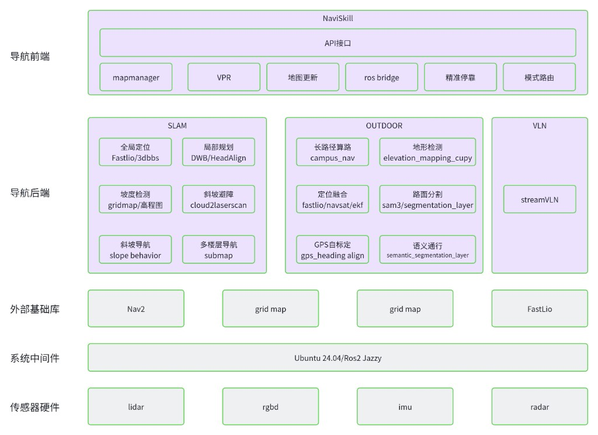

# 多模态导航设计思路（SLAM / GPS / VLN 融合）

> 状态：设计说明（Design Overview）
> 适用范围：`NaviSkill`（导航前端 / 大脑）与 `ros2_ws`（导航后端栈），覆盖室内 SLAM、
> 室外 GPS、VLN 三种导航模态及其融合调度。
> 关联文档：[`fsm_navigation_design.md`](./fsm_navigation_design.md)、
> [`submap_system.md`](./submap_system.md)、[`ros_topics.md`](./ros_topics.md)、
> [`NAVIGATION_WEBSOCKET_API.md`](./NAVIGATION_WEBSOCKET_API.md)、
> [`vpr_bootstrap.md`](./vpr_bootstrap.md)

---

## 1. 从巡检需求出发：为什么需要多模态导航

### 1.1 巡检任务的真实场景

机器人巡检不是"在一张干净地图里从 A 走到 B"这么简单。一个典型的园区 / 厂区 / 楼宇巡检任务，
往往在**同一条路线内**就横跨了性质完全不同的环境：

- **室内、结构化、封闭**：楼内走廊、机房、地下车库。GPS 完全不可用，但几何结构稳定、
  可以预先建图。
- **室外、开阔、半封闭**：园区道路、广场、建筑之间的连廊。GPS 可用但精度随遮挡波动，
  环境大到无法用单张点云地图覆盖。
- **跨楼层、跨建筑**：需要经电梯、坡道在多张地图 / 多个楼层之间连续切换。
- **长程、开放世界**：巡检里程可达数公里，沿途会遇到**建图时不存在**的临时障碍、
  施工区域、未预先标注的路径，甚至只能用自然语言描述的目标（"沿着这条路一直走到
  尽头的岗亭"）。

### 1.2 巡检对导航的四条硬性要求

把上面的场景抽象出来，巡检对导航能力提出了四个必须同时满足的要求：

1. **全域通行（室内 + 室外无缝）**：一次任务里能连续跨越室内外、开放与封闭区域，
   段间自动切换而不需要人工干预或重启。
2. **长程稳定**：数公里、数十分钟的连续运行中定位不发散、不丢失，代价地图对
   动态障碍与地形（坡度、路沿、台阶）鲁棒。
3. **自适应**：环境模态变化时（进楼、出楼、上坡、进入无图区域）能自动感知并切换到
   最合适的定位 / 规划后端。
4. **可泛化**：面对**建图时未见过**的区域和目标，仍能依靠通用感知（视觉语言）完成通行，
   而不是完全依赖离线先验地图。

### 1.3 设计目标

> **在室内 / 室外、开放 / 封闭的长程巡检任务中，多模态导航"大脑"能够自适应、可泛化地
> 提供稳定的全域通行导航能力。**

这句话拆开就是三个关键词：

- **多模态**：不押注单一定位 / 规划范式，而是同时具备 SLAM、GPS、VLN 三种能力。
- **大脑（自适应调度）**：有一个统一的前端把路线解析为异构航点序列，逐段判断类型并
  路由到对应后端，在段间自动切换模态。
- **全域 + 稳定 + 可泛化**：室内外全覆盖（全域）、长程不发散（稳定）、无图也能走（可泛化）。

---

## 2. 三种导航模态的优缺点：为什么必须融合

单独任何一种导航都无法覆盖 §1 的全部需求。下面逐一分析，并说明它们如何互补。

### 2.1 SLAM 导航（室内 / 结构化）

基于激光 SLAM（FAST-LIO2 提供 `map→odom` 里程计 + 点云先验地图 + 3D-BBS 全局重定位），
配合 Nav2 做局部规划。

**优点**
- **室内高精度**：厘米级定位，不依赖任何外部信号，封闭环境（隧道、车库、机房）照常工作。
- **几何稳定**：结构化环境里点云匹配可靠，定位不漂移。
- **先验丰富**：预建地图上可标注语义点位、门 / 电梯 / 坡道等 portal，支持多楼层 submap 切换。

**缺点**
- **依赖先验地图**：必须先建图，且地图要维护；环境大范围变化后需重建。
- **不可泛化到无图区域**：没有对应 submap 就无法定位。
- **大尺度受限**：室外开阔、特征稀疏或大范围场景下，单张点云地图既不经济也易退化。

### 2.2 室外 GPS 导航（室外 / 开放）

基于 GNSS + `navsat_transform`（UTM 投影）+ EKF 融合 FAST-LIO 里程计，用 `campus_nav`
在 OSM 路网上做长程算路，Nav2 执行；配合 `gps_heading_align` 做航向自标定、
`elevation_mapping_cupy` / 语义分割层做地形与路面通行判断。

**优点**
- **无需先验点云地图**：只要有 GPS 与路网，就能覆盖**任意大**的室外区域，天然适合长程。
- **全局无漂移**：GPS 提供全局绝对位置，里程计长距离累积误差被持续校正。
- **路网级规划**：`campus_nav` 能在公里级道路图上算出合理路径。

**缺点**
- **信号依赖**：进楼、树荫、高楼峡谷、连廊下 GPS 会退化甚至丢失，精度随遮挡波动。
- **定位精度低于 SLAM**：米级/亚米级，且源切换时易产生位姿跳变（需 UTM 度量统一、
  协方差门限等手段抑制，见 `outdoor_localization` 相关设计）。
- **不理解语义目标**：只能到坐标 / 路网点，无法响应"走到那个岗亭"这类描述性指令。

### 2.3 VLN 导航（开放世界 / 无图 / 语义指令）

Vision-Language Navigation：以自然语言指令 + 实时图像驱动 VLN 大模型（如 StreamVLN）
做推理决策，底层用 3D 激光生成局部代价地图做避障。

**优点**
- **强泛化**：无需先验地图，面对**从未建图**的区域也能依靠通用视觉理解通行。
- **语义级目标**：可直接执行描述性 / 指令性任务（"沿人行道直行，在第二个路口右转"）。
- **兜底能力**：SLAM 无图、GPS 无信号的"双盲"区域，VLN 是最后的通行手段。

**缺点**
- **精度与可靠性有限**：大模型决策存在不确定性，不适合要求厘米级停靠的场景。
- **算力 / 时延成本高**：推理开销大，闭环频率受限。
- **缺乏全局最优保证**：偏向局部反应式导航，长程全局规划仍需路网 / 地图配合。

### 2.4 三者互补：融合的必要性

把三者的短板与长板对齐，可以看到它们恰好**两两互补、缺一不可**：

| 需求 / 场景 | SLAM | GPS | VLN |
|---|:---:|:---:|:---:|
| 室内 / 封闭（无 GPS） | ✅ 强 | ❌ 失效 | ⚠️ 兜底 |
| 室外 / 开放 / 长程 | ⚠️ 受限 | ✅ 强 | ⚠️ 兜底 |
| 高精度停靠 | ✅ 强 | ⚠️ 一般 | ❌ 弱 |
| 无先验地图 / 未知区域 | ❌ 需图 | ⚠️ 需路网 | ✅ 强 |
| 语义 / 自然语言目标 | ❌ | ❌ | ✅ 强 |
| 全局无漂移 | ⚠️ 局部 | ✅ 强 | ❌ |

结论很清晰：

- **只有 SLAM**：出不了楼、覆盖不了大尺度室外。
- **只有 GPS**：进不了楼、给不了高精度、听不懂语义目标。
- **只有 VLN**：精度 / 可靠性不足以独立承担全程，且长程缺乏全局最优。

**只有三者融合**——室内交给 SLAM、室外长程交给 GPS、无图 / 无信号 / 语义目标交给 VLN，
并由统一大脑按段调度——才能同时满足巡检对"全域、稳定、自适应、可泛化"的全部要求。
这也是本系统把导航做成**多模态、逐航点路由**的根本原因：一条巡检路线被解析为异构航点序列，
每个航点标注自身类型（map / gps / VLN 指令），大脑逐段选择后端并在段间无缝切换
（详见 [`fsm_navigation_design.md`](./fsm_navigation_design.md)）。

---

## 3. 整体架构

系统采用**分层架构**：上层是与硬件无关的"导航大脑"（前端），中层是三套并列的模态化
"导航后端"，下层依次是外部基础库、系统中间件与传感器硬件。分层的意义在于——上层只做
**调度与语义**，模态差异全部封装在后端里，从而做到"换环境不换大脑"。

### 3.1 导航前端（NaviSkill —— 导航大脑）

`NaviSkill` 是整个系统的中枢，对外通过 **WebSocket RPC（`/ws`）API 接口**暴露导航能力，
对内编排后端。核心职责：

- **API 接口**：统一的 RPC 入口，客户端以 `{"method": ..., "params": ...}` 下发目标 / 路线，
  查询状态（见 [`NAVIGATION_WEBSOCKET_API.md`](./NAVIGATION_WEBSOCKET_API.md)）。
- **mapmanager（地图管理）**：语义点位、portal、路线的统一数据门面，屏蔽室内 SLAM 地图与
  室外 Scene/OSM 两种数据模型的差异（见 [`submap_system.md`](./submap_system.md)）。
- **VPR（视觉重定位）**：基于相机的位置识别，作为 SLAM 定位丢失时的重定位手段
  （见 [`vpr_bootstrap.md`](./vpr_bootstrap.md)）。
- **地图更新**：与 mapserver 增量同步地图数据（SHA256 增量）。
- **ros bridge**：前端与 ROS2 后端（`NavNode`）之间的桥接，负责 TF / 定位状态 / `cmd_vel` /
  Nav2 action 的收发。
- **精准停靠**：终点段的高精度对位（对应路网末点从 `navigate_through_poses` 切换到
  `navigate_to_pose` + precise goal checker 的两段式逼近）。
- **模式路由（自适应调度）**：把路线解析为异构航点序列，逐段判断类型并路由到 SLAM /
  GPS / VLN 后端，通过导航到 portal → 启动目标模态栈 → 等定位稳定，完成模态切换。

> 前端是"与硬件无关"的一层：它只关心"当前该用哪种模态、切换到哪里、是否已定位稳定"，
> 而不关心具体的定位算法。这正是"自适应、可泛化"能落地的结构基础。

### 3.2 导航后端（三套并列模态栈）

#### SLAM 栈（室内 / 结构化）
- **全局定位 `Fastlio / 3dbbs`**：FAST-LIO2 提供 LiDAR-惯性里程计（`map→odom`），
  3D-BBS 提供全局重定位 / 初始位姿。
- **局部规划 `DWB / HeadAlign`**：Nav2 局部控制器，配合航向对齐。
- **坡度检测 `gridmap / 高程图`**：从点云构建高程 / 坡度层。
- **斜坡避障 `cloud2laserscan`**：把 3D 障碍投影为 2D 激光供代价地图使用。
- **斜坡导航 `slope behavior`**：坡道场景的专用行为。
- **多楼层导航 `submap`**：submap + portal 支持跨楼层 / 跨地图连续切换。

#### OUTDOOR 栈（室外 / 开放 / 长程）
- **长路径算路 `campus_nav`**：OSM 路网上的公里级全局路由。
- **地形检测 `elevation_mapping_cupy`**：GPU 高程图，感知地形起伏。
- **定位融合 `fastlio / navsat / ekf`**：GNSS 经 UTM 投影后与 LIO 里程计在 EKF 中融合，
  全局无漂移。
- **路面分割 `sam3 / segmentation_layer`**：图像分割识别可行驶路面。
- **GPS 自标定 `gps_heading align`**：行进中在线标定航向。
- **语义通行 `semantic_segmentation_layer`**：语义代价层，让机器人沿人行道 / 可通行区域行走。

#### VLN 栈（开放世界 / 无图 / 语义指令）
- **`streamVLN`**：视觉语言导航模型，以自然语言指令 + 实时图像做反应式决策，
  底层用 3D 激光生成的局部代价地图避障。作为无图 / 无信号 / 语义目标场景的通行能力与兜底。

> 三套后端**并列**而非层叠：同一时刻由前端选择其一驱动底盘，段间切换。SLAM 与 OUTDOOR
> 互斥（都发布 `map→odom`），切换其一会停掉另一栈。

### 3.3 外部基础库

模态栈复用成熟的开源基础库，降低自研成本、聚焦差异化能力：

- **Nav2**：SLAM / OUTDOOR 共用的导航框架（行为树、规划器、控制器、代价地图）。
- **grid map**：高程 / 坡度 / 地形代价层的底层数据结构（室内外各用一套配置）。
- **FastLio**：LiDAR-惯性里程计，SLAM 与 OUTDOOR 定位的公共前端。

### 3.4 系统中间件

- **Ubuntu 24.04 / ROS2 Jazzy**：统一的操作系统与通信中间件。所有节点通过 ROS2 话题 /
  服务 / action / TF 通信，为多模态节点的解耦与热切换提供基础。

### 3.5 传感器硬件

- **lidar**：SLAM / OUTDOOR 定位与避障的主传感器。
- **rgbd**：VPR、路面 / 语义分割、VLN 的视觉输入。
- **imu**：与 LiDAR 紧耦合提供高频里程计。
- **radar**：恶劣天气 / 特定场景下的补充感知。

### 3.6 数据流与自适应切换（贯穿三层）

一条巡检路线的执行链路，正是"前端调度 + 后端执行"的贯穿：

1. 客户端经 **API 接口**下发一条路线；**mapmanager** 将其解析为异构航点序列。
2. **模式路由**逐航点判断类型：
   - `map` 段 → 唤起 **SLAM 栈**（FAST-LIO 定位 + Nav2）。
   - `gps` 段 → 唤起 **OUTDOOR 栈**（GNSS/EKF 定位 + campus_nav 路网 + Nav2）。
   - VLN 指令段 → 唤起 **VLN 栈**（StreamVLN + 局部避障）。
3. 段与段之间通过 **portal** 衔接：先在当前模态下导航到 portal 点，再启动目标模态栈，
   等待其定位稳定（SLAM 看 `map→base_link` TF 新鲜度，GPS 看 fix 新鲜度），才继续下一段。
4. 途中 **VPR** 监视 SLAM 定位丢失并触发重定位；**精准停靠**在终点段做高精度对位。

这一闭环让系统在室内外、开放 / 封闭、有图 / 无图之间**自适应**流转，对上层调用者
表现为**一个统一、稳定、全域可达**的导航大脑——即 §1.3 的设计目标。

---

## 4. 小结

- 巡检的真实需求（全域、长程、自适应、可泛化）决定了导航不能押注单一范式。
- SLAM（室内精准）、GPS（室外长程）、VLN（无图 / 语义泛化）**两两互补**，三者融合才完整。
- 系统以**分层 + 多模态 + 逐航点路由**的架构落地这一思路：NaviSkill 作为与硬件无关的
  导航大脑做调度，三套并列后端封装模态差异，复用 Nav2 / grid map / FastLio 等基础库，
  运行于 ROS2 Jazzy 之上，最终对外呈现为稳定的全域通行导航能力。
