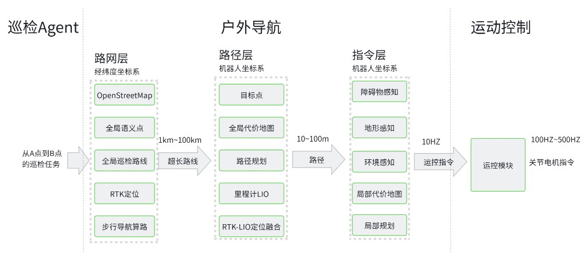

# 户外导航技术架构（Outdoor Navigation Architecture）

> 状态：架构说明（Architecture Overview）
> 适用范围：户外 / 园区（campus）GPS 导航模态，覆盖从「巡检任务」到「关节电机指令」
> 的完整纵向链路。
> 关联文档：[`multimodal_navigation_design.md`](./multimodal_navigation_design.md)、
> [`fsm_navigation_design.md`](./fsm_navigation_design.md)、
> [`NAVIGATION_WEBSOCKET_API.md`](./NAVIGATION_WEBSOCKET_API.md)

---

## 1. 架构总览



户外导航是一条**纵向分层**的流水线：上游把「从 A 点到 B 点的巡检任务」逐层翻译成
越来越具体、越来越高频的指令，最终落到运控模块的关节电机。全链自上而下分为四层，
每层有明确的**坐标系**、**时间/空间尺度**和**运行频率**：

| 层 | 坐标系 | 空间尺度 | 频率 / 时机 | 核心职责 |
|---|---|---|---|---|
| **巡检 Agent** | 经纬度（WGS84） | — | 任务级（一次下发） | 把巡检意图变成"到某经纬度 / 语义点" |
| **路网层** | 经纬度 → 局部 ENU | 1 km ~ 100 km | 每个任务一次算路 | 超长路网算路 + 绝对定位 |
| **路径层** | 机器人系 | 10 m ~ 100 m | 全局重规划（按需） | 全局代价图 + 全局路径 + 融合定位 |
| **指令层** | 机器人系 | ≤ 局部窗（约 10 m） | 局部规划（高频） | 实时感知 + 局部代价图 + 局部规划 |
| **运动控制** | 机器人 / 关节 | — | 100 Hz ~ 500 Hz | 速度指令 → 关节电机 |

层与层之间的"接口物"正是图中箭头上的标注：

```
巡检Agent ──(A→B 任务)──▶ 路网层 ──(1km~100km 超长路线)──▶ 路径层
        ──(10~100m 路径)──▶ 指令层 ──(运控指令)──▶ 运动控制 ──(关节指令 100~500Hz)──▶ 电机
```

**一句话概括设计**：用**低频、大尺度、绝对坐标**的路网层解决"往哪走"，用**中频、中尺度、
机器人系**的路径层解决"这一段怎么绕"，用**高频、小尺度、实时感知**的指令层解决"下一步
别撞 / 别翻"，层层收敛频率与尺度，最后交给最高频的运控闭环。

---

## 2. 为什么这样设计（设计目标与考虑因素）

分层不是为了好看，每条边界都对应一个绕不开的现实约束：

### 2.1 单张地图覆盖不了数公里 → 路网 / 局部两级地图
巡检里程可达数公里到上百公里，**不可能**用一张稠密地图覆盖。于是：
- **路网层**只存**拓扑与经纬度**，很小的体量就能覆盖整个园区，负责"选哪条路"；
- **路径层 / 指令层**只在机器人周围**几十米的滚动窗**里维护稠密的代价栅格，负责"这条路上怎么走"。
两者尺度差 3~4 个数量级，强行合并会同时牺牲覆盖范围和实时性。

### 2.2 绝对定位会跳、相对定位会漂 → 融合定位
- **卫星定位（RTK/GNSS）**给的是**全局绝对**位置，但在建筑 / 树冠遮挡下会突跳、丢星；
- **激光惯性里程计（LIO）**给的是**高频、平滑**的局部位姿，但长时间会累积漂移。
单用任何一个都不够。架构上让绝对定位负责**低频纠偏**、里程计负责**高频平滑**，两者在
坐标变换链上**串联**而非争抢，取长补短（见 §5.2）。

### 2.3 坐标系必须"各司其职" → 经纬度 vs 机器人系的清晰边界
- 上游 Agent / 路网层用**经纬度**思考（人和地图数据的自然表达）；
- 路径层及以下用**机器人系**思考（规划器 / 代价图的数学基础）。
边界上用一个**固定基准点**把经纬度锚定成本地平面坐标，全局帧原点与路网帧原点严格重合。
**基准点一旦上下不一致，整张路网就会整体平移** —— 所以它被设计成全栈唯一真值，只声明
一次并向定位与路网两侧同时透传。

### 2.4 感知与规划解耦，地形 / 障碍分链 → 鲁棒且互不拖累
园区里"障碍"有三种性质完全不同的东西：**动态障碍**（人、车）、**地形**（坡度、路沿、
台阶、悬崖）、**语义**（草坪）。它们的时间常数、清除策略都不同：
- 动态障碍**带实时清除**（人走开就消失）；
- 地形**持久累积**（路沿一直记得）；
- 语义作为软约束叠加。
分链使得这些相反的需求可以共存，任何一类的抖动都不会拖垮其它类。

### 2.5 频率金字塔 → 慢的在上、快的在下
任务级算路一次即可；全局重规划**按需**触发（路径过期 / 目标变 / 失效），避免围着对称
障碍反复翻导致左右震荡；局部规划高频、速度平滑更高频、运控最高频。每层只在必要频率上
工作，既省算力又稳定。

### 2.6 安全是横切关注点 → 多重兜底
规划阶段用真实车身足迹逐轨迹判撞；速度链末端有碰撞监视器（进入危险区即降速 / 刹停）；
整栈异常退出时有独立守卫补发零速；卡死时由行为树清图重建。任一环失效都有下一环兜底
（见 §5.5）。

### 2.7 启动有严格依赖顺序 → 错峰拉起
坐标变换链是一切的根基：定位不先立起全局帧到机器人帧的变换，代价图无法激活；导航内核
不就绪，路网层的目标就无处可发。所以整栈**错峰**启动：先定位、再导航内核、后路网
（见 §5.4）。

---

## 3. 逐层详解

### 3.1 巡检 Agent（任务层）

- **输入**：人 / 上层业务系统的巡检意图（"去 B 点岗亭巡检"、"沿 A 线路巡一圈"）。
- **输出**：一个或一批**目标**，以经纬度或**全局语义点**（预先标注的命名地点）表达。
- **角色**：只关心"去哪"，不关心"怎么走"；并负责在**室内 SLAM / 室外 GPS** 等模态之间做
  选择与切换。
- **坐标系**：经纬度。

### 3.2 路网层（Road-Network Layer）

**坐标系：经纬度 → 局部 ENU。空间尺度：1 km ~ 100 km。** 负责在整个园区路网上求出一条
**超长路线**，并提供全局绝对定位。对应图中五个能力：

- **OpenStreetMap 底图**：园区路网来源，按"人 / 机器人可通行"过滤出道路，连成一张
  节点 / 边构成的**拓扑图**。
- **全局语义点**：命名地点 / 建筑入口，作为算路的起终点候选。
- **全局巡检路线**：预定义的多点巡检回路。
- **RTK 定位**：卫星定位 + **航向对齐** —— 机器人走够一小段直线后锁定绝对朝向，并把
  全局帧原点钉在固定基准点上。
- **步行导航算路**：在拓扑图上求最短路，转成本地平面坐标后，作为**分批目标**下发给路径层。

**关键行为**：路线以本地 ENU 表达，与定位提供的全局帧同源；算路结果不是一次喂完，而是
分批下发，并配合"首锁"逻辑 —— 未锁航向时先放行让机器人动起来（锁定需要运动，扣住会
陷入"鸡生蛋"），锁定后纠正朝向并重发当前批次。

### 3.3 路径层（Path Layer）

**坐标系：机器人系。空间尺度：10 m ~ 100 m。** 负责把路网层给的一段目标，在**机器人周围
的全局代价图**里规划出一条可行**路径**，并维护融合定位。对应图中五个能力：

- **目标点**：路网路点转成机器人系下的位姿目标序列。
- **全局代价图**：随机器人滚动的代价栅格，地形代价在一定窗口内**持久累积**。
- **路径规划**：在全局代价图上求出一条到目标的路径并做平滑。
- **里程计 LIO**：激光惯性里程计融合 IMU 与轮速，提供高频、平滑的机器人位姿。
- **RTK-LIO 定位融合**：卫星定位周期性纠正里程计漂移，二者串联成完整的定位链。

**关键行为**：全局规划**按需**触发而非无条件周期重规划，避免在对称障碍两侧反复翻导致
车身左右震荡；清代价图后有短暂 settle 等待，防止"清完立刻从刚清掉的障碍里穿过去"。

### 3.4 指令层（Command Layer）

**坐标系：机器人系。空间尺度：局部窗（约 10 m）。** 这是把"路径"落成"下一步速度"的地方，
也是所有实时感知汇聚的地方。对应图中五个能力：

- **障碍物感知**：实时点云相对局部地面做高度带过滤，得到动态障碍，带射线清除。
- **地形感知**：GPU 高程图 → 坡度分级代价 + **悬崖 / 负障碍**检测，作为持久地形代价。
- **环境感知**：相机语义（如草坪）作为软约束（当前默认关闭，待模型适配园区后开启）。
- **局部代价图**：把上述三类感知融合成机器人周围的实时代价栅格。
- **局部规划**：在局部代价图上采样候选轨迹并打分，选出兼顾"贴路径、朝向对、不撞、
  过窄路、上坡稳"的速度指令。

**关键考虑**：局部规划用**真实车身足迹（含朝向）**判撞，是过窄路的关键；并配有航向对齐
与上坡重心控制等定制评价，针对园区实际工况整定。

### 3.5 运动控制（Motion Control）

**频率：100 Hz ~ 500 Hz。** 接收指令层输出的速度指令，在关节层闭环成电机指令。此层是
**外部底盘固件**，本架构通过一个标准速度指令接口与之解耦，从而与具体底盘型号无关。

---

## 4. 端到端数据流（一次 A→B 任务）

```
① 巡检Agent: "去 B 点"(经纬度 / 语义点)
        ▼
② 路网层: 拓扑图算路 → 本地 ENU 路点序列
          RTK + 航向对齐 → 钉全局帧原点, 提供绝对定位(低频纠偏)
        │  分批目标
        ▼
③ 路径层: 里程计 LIO(高频平滑) + RTK 融合(纠偏) → 完整定位链
          全局代价图 → 全局路径
        │  路径
        ▼
④ 指令层: 障碍感知 + 地形感知(含悬崖) + 环境感知 → 局部代价图
          局部规划 → 速度指令
        │  平滑 + 碰撞监视
        ▼
⑤ 运动控制: 底盘固件 → 关节电机(100~500Hz)
```

---

## 5. 横切机制（Cross-cutting Concerns）

### 5.1 坐标系与变换链

```
全局帧 ──(RTK 航向对齐, 低频纠偏)──▶ 里程计帧 ──(LIO, 高频平滑)──▶ 机器人本体 ──▶ 传感器
   │
   └──(同源同原点)──▶ 路网帧(本地 ENU)
```

- 全局帧原点由航向对齐钉在**固定基准点**上；
- 路网帧与全局帧同一原点、同一朝向，二者变换恒定；
- **基准点是全栈唯一真值**，只声明一次并同时透传给定位与路网，杜绝路网整体平移。

### 5.2 融合定位（绝对 + 相对）

- **里程计（LIO）**：高频、连续、平滑；短时精度高，长时会漂 → 负责机器人本体的实时位姿。
- **卫星定位（RTK/GNSS + 航向对齐）**：全局绝对，但会跳变 → 周期性把里程计相对全局帧的
  漂移纠回。
- 二者在变换链上**串联**：上层始终能拿到既平滑（里程计段）又不漂（卫星锚定）的全局位姿。

### 5.3 代价地图体系（三类感知如何叠加）

代价图按"**地形 → 语义 → 动态障碍 → 膨胀**"的顺序、以**取最大值**方式叠加：

- **地形代价**：坡度渐变软代价 + 陡坡 / 路沿 / 悬崖的致命代价，**持久累积**，清图不误删；
- **动态障碍**：带射线清除，人 / 车走开即消失；
- **语义**：只抬高代价、抹不掉地形写下的致命代价（当前默认关闭）；
- **膨胀**：常规安全裕度。
局部规划再用真实足迹判撞，配合较小的车身轮廓与膨胀，使窄路可通行。

### 5.4 启动依赖与错峰

| 次序 | 拉起 | 依赖原因 |
|---|---|---|
| 先 | 定位 / 建图 + 刹停守卫 | 先立变换链根基（全局帧 → 机器人本体） |
| 中 | 导航内核（规划 / 控制 / 代价图） | 代价图激活需要变换链已存在 |
| 后 | 路网 / 路由 | 下发目标需要导航内核就绪 |

启动时还会清理上一次遗留的孤儿感知进程，避免同名节点叠加把感知数据打乱。

### 5.5 安全链（多重兜底）

1. **足迹判撞**：规划阶段筛掉会撞的候选轨迹；
2. **碰撞监视**：速度链末端，进入危险区降速 / 刹停；
3. **刹停守卫**：整栈异常退出时补发零速，防止底盘保持最后一条速度指令；
4. **行为树 recovery**：卡死时清代价图 + settle 等待重建（对四轮转向底盘已去掉容易甩尾的
   原地自旋 / 倒车）。

---

## 6. 小结

户外导航用**四层纵向分层**把一个模糊的巡检意图，逐层收敛成确定的电机指令：

- **路网层**在超大尺度、绝对坐标下解决"往哪走"；
- **路径层**在中尺度、机器人系下解决"这段怎么绕"，并用融合定位保证长程不漂；
- **指令层**在小尺度、实时感知下解决"下一步别撞别翻"，用分链感知兼顾动态障碍与持久地形；
- **运动控制**在最高频完成关节闭环，并通过标准速度接口与底盘解耦。

贯穿全栈的三条主线是：**坐标系分工（经纬度 ↔ 机器人系，以唯一基准点衔接）**、
**融合定位（绝对纠偏 + 相对平滑）**、**分层的频率与安全兜底**。
